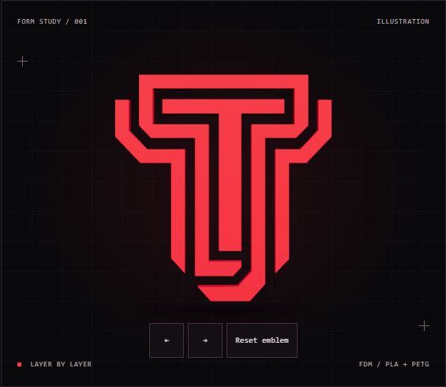
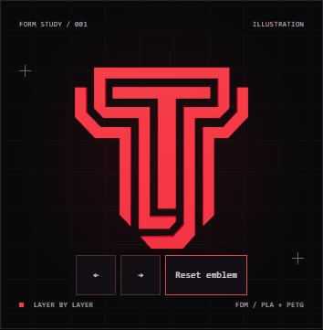
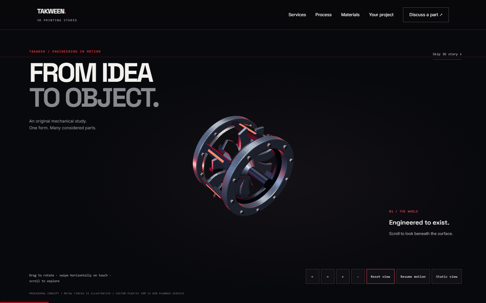
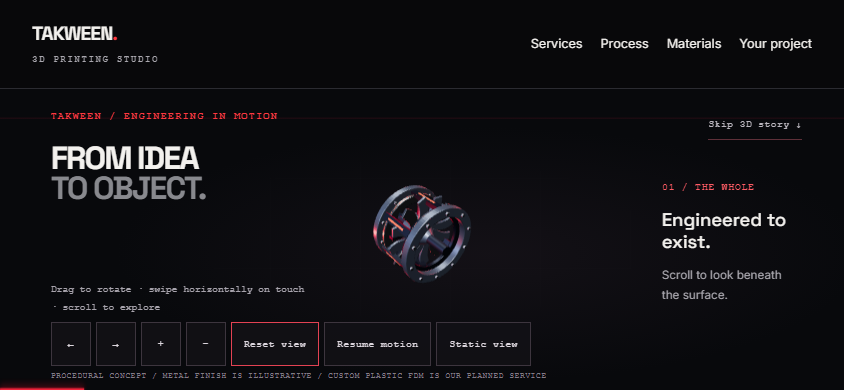

# TAKWEEN LABS — performance and enquiry reliability engineering

22–23 November 2026. Branch: codex/combined-release; starting commit eca86ea6b21782ac3cae65ae3bcb4165b00d3577; draft PR #4. No deployment, merge, DNS change, indexing activation, database operation or genuine email sending is authorized or performed by this work.

## Implemented fixes

| Confirmed issue | Evidence / root cause | Implemented fix |
|---|---|---|
| Unused Three.js classes and canvas plumbing in startup | R3F Canvas registers the entire THREE namespace. Shared scene chunk was 881,012 bytes. Existing scenes use outer DOM gestures, not mesh raycasting. | SceneCanvas uses the documented R3F createRoot + granular extend API. Registers the actual scene elements, uses ResizeObserver, retains R3F camera/DPR/renderer/frame-loop configuration and propagates renderer errors to existing fallback boundaries. Shared chunk is about 702 KB. No dependency added. |
| Hero rebuilt after leaving viewport/backgrounding | Original hero unmounted its scene on every inactive transition. Five scroll-return cycles created five additional contexts and reran GPU/resource initialization. | Keep the visited hero root/resources mounted; stop its timer and frame updates while inactive. Reduced motion, failure and actual component removal still unmount and dispose. Preserve current orientation on return. |
| Hidden-root pause edge case in the optimization | A zero-sized hidden container could drop updated child props if resizing simply returned early. | Apply pause props to an already initialized root without resizing its camera to zero. A regression counts actual draw calls: idle rendering must first be active, then stop offscreen. |
| Pending enquiry could be edited | Reproduced a failing browser assertion: name/details remained enabled while a request was outstanding. Acceptance could otherwise appear beside edited details that had not been submitted. | Disable enquiry inputs/file selection while sending; preserve values and re-enable on completion/failure. Existing duplicate-submit ref and retry UUID retained. |
| Browser request could remain pending indefinitely | Client fetch had no deadline; provider's 10s server deadline cannot guarantee a response reaches a stalled browser connection. | Real browser AbortSignal.timeout(20000), with existing uncertainty wording and manual draft/email recovery. Actual 20s deadline exercised by browser test; not a fake clock. |
| Whitespace-only provider ID incorrectly counted as acceptance | New mocked unit reproduced HTTP 202 for an all-whitespace ID. This is malformed-response hardening, not an observed Resend incident. | Server and browser require a nonblank ID. Valid provider responses are unchanged. |
| Rejected local file lacked a clear recovery action | Error told the customer to remove/replace the file, but there was no clear button. A new browser test reproduced the missing action. | Add a conditional local-only Clear selected file button, disabled while sending. Clears the native selection/error without discarding other enquiry inputs or uploading anything. |
| Ignored benchmark prototypes entered TypeScript validation | tsc --listFilesOnly included the isolated baseline's generated routes/source under ignored artifacts/. | Exclude artifacts/ consistently with existing Git/lint exclusions. All committed application and test sources remain typechecked. No checks disabled. |

The original gear's assembly-experience.tsx and assembly-timeline.ts are unchanged. mechanical-scene.tsx only changes the Canvas import to the adapter. Geometry generation, mesh counts, materials, lights, environment, camera settings, transforms and gestures remain unchanged. In particular, the original section observer and 180px preload margin remain unchanged: no later trigger, delayed story, placeholder gate or reduced resolution was introduced.

The T's contours, extrusion, bevels, materials, lighting, visible idle math, drag limits and reset math remain unchanged. Both scenes still have independent WebGL renderers and share R3F's existing animation scheduling. There is no new animation loop. Existing DPR caps are retained. The adapter is intentionally scoped to these scenes; future scenes needing mesh-level pointer events or DOM context bridging must explicitly add those facilities.

## Rejected experiments

1. Next optimizePackageImports for Three/Drei/R3F: identical 881,012-byte scene chunk; reverted.
2. Cancellable asynchronous hero shader preparation: benchmark regression, particularly desktop; reverted. Shader diagnostics were never disabled.
3. Minimal procedural environment wrapper: six pixel comparisons were exact and transfer shrank, but blocking-time measurements did not show a reliable benefit. Reverted; the original Drei Environment and Lightformers remain.

Only the smaller R3F root/catalogue, hero lifecycle fix and enquiry reliability changes are retained. Raw unsuccessful batches remain available; they are not relabelled as improvements.

## Performance methodology and measured results

Lighthouse 13.6.0 / Chromium 156 on Windows. WebGL identifies itself as **ANGLE SwiftShader software rendering**, not a physical Android/iPhone GPU or integrated laptop GPU. No physical device was available. Native driver/GPU timing, battery/thermal behavior, real-device frame rate, field CWV and INP are unverified.

Earlier sequential batches varied substantially: original mobile scores 47–52 and desktop 71–81; a later candidate batch fell to mobile 40–49 and desktop 43–46. A contemporaneous original control also slowed dramatically. It would be misleading to attribute those cross-batch differences solely to code or quote one favorable score. All five six-run batches and the final twelve alternating control runs are retained in the summary JSON.

The final Lighthouse comparison uses independent cold browser profiles and alternating original/candidate order (before/after, after/before, before/after) at each preset. Original is the exact starting commit in an isolated build; its temporary dependency-resolution root differs, with the same dependency installation, fonts, scene content and viewport. Candidate is the final production build. No benchmarks ran alongside builds or browser test suites.

| Final paired Lighthouse medians, n=3 per variant/preset | Original | Candidate | Interpretation |
|---|---:|---:|---|
| Mobile performance | 38 | 38 | Score target not achieved |
| Mobile LCP | 14.473s | 11.709s | 19.1% reduction; still poor |
| Mobile TBT | 16,937.5ms | 12,769.5ms | 24.6% reduction; still poor |
| Mobile CLS | 0 | .0118 | Both below .1 |
| Desktop performance | 46 | 49 | Score target not achieved |
| Desktop LCP | 3.228s | 2.908s | 9.9% reduction |
| Desktop TBT | 3,979ms | 2,292ms | 42.4% reduction; still too high |
| Desktop CLS | .000534 | .000534 | No material change |

These absolute results are not representative phone measurements or proof of a real-device regression from the previous audit. The paired improvement supports reduced startup work under the measured conditions; it does not certify a universal percentage improvement or 90+ performance.

A separate alternating Chromium startup probe uses 390×844, 4× CPU throttling, 150ms latency and 200,000 bytes/s download throughput. Its initial DPR=1 diagnostic yielded median hero-ready telemetry 7.001s → 6.350s, observed LCP 1.908s → 1.224s, and observed long-task excess over 50ms 2,937ms → 2,713ms. These are actual CDP-throttled observations, not Lighthouse simulated metrics or field INP. A ready attribute is not a full hardware frame-presentation measurement. Do not present the DPR=1 diagnostic as a physical-phone benchmark.

Initial decoded JavaScript in that probe: 1,457,253 → 1,278,433 bytes (12.3% less); transfer including headers: 414,428 → 368,964 bytes (11.0% less). The shared 3D chunk shrinks about 20.3%. Bundle size is a deterministic improvement independent of the noisy GPU timings. Fonts, textures, resolutions and visible content were not removed or degraded.

The final nonblank-ID and local-file recovery follow-ups were added after startup sampling; no 3D rendering/loading code changed after those measurements. The whole final application was rebuilt and retested. Exact raw samples belong to the measured renderer candidate, not a new claim of field performance for every final-source byte.

Profiles identify expensive runtime/module initialization, first render and synchronous shader-status/log reads. The diagnostic found two short-lived capability-probe contexts and two real scene contexts; the software renderer did not advertise KHR_parallel_shader_compile. Procedural geometry and shader error checks were left intact. No speculative GPU execution-time or memory-byte claim is made.

## Lifecycle and memory

Five offscreen/return cycles: cumulative created contexts 4 → 9 originally, versus 4 → 4 after optimization. These are cumulative creations, **not nine simultaneously live contexts**. Median return-to-ready telemetry was 2.802s → 2.232s in that separate diagnostic. It avoids five renderer/resource rebuilds without altering the gear's preload behavior.

Forced-GC JS heap observations: original 7,809,980 → 9,859,284 bytes; candidate 7,385,024 → 8,828,844 bytes. These are short-run JS heap observations, not GPU allocation measurements or proof of zero leaks. The optimization retains one hero's resources while offscreen, deliberately trading that bounded retention for fewer context rebuilds. Reduced-motion transition and real unmount release the renderer. Long-duration hardware memory/thermal testing remains outstanding.

## Visual and functional verification

Direct original-versus-final comparisons at 1440×900, 390×844 and 844×390 produced **changedRatio=0 and meanDelta=0** for both the neutral T and paused/reset gear: six exact comparisons. No tolerances were relaxed. Comparison screenshots and JSON are in performance-evidence/. Existing drag/reset pixel assertions remain in the suite.

The initial review crops used viewport coordinates after scrolling and truncated part of the captured mobile logo. This was a capture error, not website clipping. They were replaced by complete element screenshots of the framed emblem/stage from the original build and final Worker. Only CSS animations are frozen during those review captures; the models are reset/paused explicitly. All six complete-frame comparisons again returned zero difference. The product geometry and animation code were not changed to correct the screenshots.

| Actual renderer capture | Original | Candidate |
|---|---|---|
| Desktop T |  |  |
| Mobile T |  |  |
| Original gear |  |  |

New cases verify retained renderer identity/pose across scroll return and synthetic visibility changes, actual offscreen draw cessation, reduced-motion disposal, injected WebGL loss with usable fallback/enquiry, and DPR=3 mobile portrait/landscape resolution caps. Visibility events, CPU/network limits and devices are simulated. Browser tests do not establish physical keyboard, iPhone Safari, Android battery or hardware GPU coverage.

The existing full suite exercises reversible gear explosion, zoom, mouse/touch drag, reset, independent hero/gear readiness, desktop/mobile layouts, eleven viewport combinations, mobile menu/keyboard focus, local-only file selection, enquiry recovery and noindex controls. Runtime and CI results are finalized below before release.

## Email transport and owner-controlled delivery gate

The already passing server implementation is preserved: quantities 1–10000, strict string/schema/origin validation, 16KiB streamed body limit, honeypot rejection, native per-IP/site rate bindings, fixed recipient, plain-text formatting, server-only API key, 10s provider deadline and provider idempotency key. Success requires provider 2xx + nonempty ID; the browser additionally requires exact HTTP 202/accepted contract. Malformed/fake success, network failure, rate-limit failure and provider rejection cannot report acceptance. No email body, key or customer input is logged by the new client changes.

All automatic sending tests use mocked provider responses. Browser validation, duplicate clicks, retained inputs, retry UUID reuse, real client abort and manual mailto fallback are covered. A client abort can happen after provider acceptance; the UI correctly says acceptance could not be confirmed rather than claiming nothing was sent. The unchanged UUID permits safe retry within the provider's idempotency window. Reloading the page discards that in-memory UUID/draft; this is not permanent deduplication or enquiry storage.

Local configuration check, names/presence only: RESEND_API_KEY and RESEND_FROM_EMAIL are missing; ENQUIRY_ENABLED is disabled. Live Resend sender status/account credentials were not queried. Missing local credentials do not prove anything about remote secrets. No key values were read into the report or requested in chat.

Before an explicitly approved genuine test, the owner must:

1. Verify an owner-controlled sending domain in Resend, using the provider's DKIM/SPF records. DNS changes need separate approval; no domain/address is invented here. Use an authorized raw From address on that domain; resend.dev test senders remain rejected by the application.

   The Gmail business address is the recipient. Owning that Gmail inbox does not establish ownership of gmail.com as a sender domain.
2. Put RESEND_API_KEY in ignored local .dev.vars for an isolated Worker test, or encrypted Cloudflare secret settings for a later approved release. Configure RESEND_FROM_EMAIL server-side. Never use NEXT_PUBLIC, paste keys into chat, or commit them.
3. Configure SITE_URL to the exact test browser origin and verify ENQUIRY_IP_LIMITER / ENQUIRY_SITE_LIMITER bindings. Confirm namespace IDs do not conflict in the account. Keep SITE_INDEXING_ENABLED=false. ENQUIRY_ENABLED stays false until explicit permission to send.
4. Explicitly approve one synthetic quantity-1 message to takweenlabs.in@gmail.com. In the isolated test, verify 202/accepted with provider ID, corresponding Resend delivery event, then owner-confirmed Gmail Inbox/Spam receipt. Provider acceptance alone is not inbox delivery. Keep quantities 10/10000 mocked unless more genuine sends are approved.
5. Review privacy/retention, provider quotas and abuse monitoring before public activation. Native limits are approximate per Cloudflare location, not a worldwide budget; no challenge/global quota or delivery webhook storage was introduced. Operator delivery evidence comes from the owner-controlled provider dashboard until a separately approved status integration exists.

References: [R3F custom roots/tree-shaking](https://r3f.docs.pmnd.rs/api/canvas), [Three shader preparation](https://threejs.org/docs/pages/WebGLRenderer), [Resend domain setup](https://resend.com/docs/dashboard/domains/introduction), [Resend idempotency](https://resend.com/docs/dashboard/emails/idempotency-keys).

## Remaining gates and recommendation

- .com launch: **NO-GO**. Mobile absolute performance/real-device interaction is not signed off; genuine delivery, verified sender, domain/canonical configuration and customer-data policy remain outstanding.
- Existing controlled preview: conditional GO after final CI success and owner visual approval, with sending/indexing disabled and the documented device/performance limitations accepted. Deployment remains prohibited until owner approval. No promise of 90+ mobile/desktop scores.
- The next performance decision is representative hardware testing. Any proposal to delay the original gear's preload must explain potential loading-cue/fast-scroll impact and obtain approval first. No such delay is included here.
- Dependency audit remains 11 moderate entries, zero high/critical. No dependency versions or lockfile changed; previously documented build/lint advisories were not hidden by an unsafe override.

## Changed files

- src/components/scene-canvas.tsx: scoped renderer adapter, granular catalogue, resizing, error forwarding and cleanup.
- src/components/hero-emblem/emblem-scene.tsx and hero-emblem.tsx: adapter use, visibility pause and resource retention; approved visual math/resources unchanged.
- src/components/assembly/mechanical-scene.tsx: Canvas adapter import only; original scene/environment/preload retained.
- src/components/quote-form.tsx: pending-input lock, client deadline, nonblank acceptance guard and local-file error recovery.
- src/lib/enquiry-handler.ts and tests/enquiry-delivery.test.ts: reject a whitespace-only provider ID, with a failing-then-passing regression.
- tests/browser/hero-emblem.spec.ts and enquiry-delivery.spec.ts: targeted lifecycle/DPR/failure/deadline regressions.
- tsconfig.json: exclude ignored local diagnostic artifacts from compilation.
- This report and performance-evidence/: measured results and review screenshots. Raw lab harnesses/traces stay in ignored artifacts/deep-performance/.

## Completed local verification

| Final verification | Result / evidence |
|---|---|
| ESLint and TypeScript | Passed, including all final committed source/tests |
| Unit suite | 29 passed; mocked provider, malformed/nonblank IDs, quantity boundaries, actual 10s provider abort, rate/origin/stream limits |
| Next production build | Passed after final file-recovery and acceptance fixes |
| Next full browser suite before the last email-only follow-ups | 48 passed, 12 platform-specific skips |
| Final affected Next enquiry suite | 10 passed after nonblank-ID fix; local-file recovery subsequently passed in both Chromium and WebKit |
| Final OpenNext / Wrangler dry run | Passed, 4938.74 KiB raw / 1046.43 KiB gzip; no upload |
| Native local workerd + rate bindings | Passed, mocked provider: five 202 responses then two 429s |
| Full final application browser suite on real local workerd | 50 passed, 12 project-specific skips, zero failures, about four minutes |
| Additional actual internal navigation/back test | Three route-return cycles passed separately on Next and the local Worker, including deferred teardown and reset |
| Firefox applicable suite | 19 passed; Chromium-specific mechanisms/duplicate matrices excluded, no physical Firefox phone claim |
| Axe / layouts | Zero automated WCAG A/AA violations, page exceptions or overflow in 9 reduced-motion browser/layout combinations (Chromium/Firefox/WebKit × desktop/mobile/landscape) |
| Final renderer visual comparison | Six exact original/candidate comparisons, zero changed pixels; no image assertions loosened |
| Dependency / secret boundaries | 11 moderate advisories, 0 high/critical; env files remain ignored; public chunks match no server-secret markers checked |

The additional navigation/back regression was added after the full local Worker suite and executed separately; it will also run in the final GitHub full suite. Platform-specific skips represent unsupported CDP/active-WebGL mechanisms and duplicate viewport matrices, not skipped failures. No existing timeout or retry policy was relaxed.

One accessibility helper initially targeted the stopped localhost:3110 server and failed connection-refused. It was corrected to the running final Worker at :8795 and all nine combinations passed. The isolated baseline also initially needed a workspace-local dependency junction/Turbopack resolution root; that setup failure was not counted as an application build pass. Red-phase pending-field, whitespace-ID and missing-file-clear failures were reproduced before fixing them.

Local verification supports **conditional GO for an owner-reviewed foundation preview update**, retaining disabled sending/indexing and acknowledging software-GPU performance/physical-device limitations. It is **NO-GO for the commercial .com launch**. The final remote CI conclusion must be read from the pushed commit's Actions runs; local results do not substitute for it. No publication is performed by this recommendation.

Application-source commit 5ac43383f3b3c7738a26fa8844e97fd91a2a7e18 passed both hosted workflows: [push run](https://github.com/zeez000/takween/actions/runs/45056789553) and [PR run](https://github.com/zeez000/takween/actions/runs/45056987916). Hosted logs confirm 29 unit passes and 51 browser passes with 13 project-specific skips. The complete-frame screenshot correction is a documentation-only follow-up; its final CI result is reported in PR #4 and the completion report.
