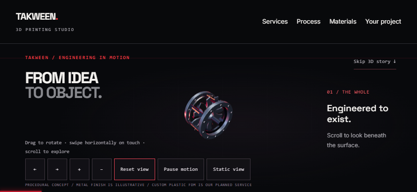
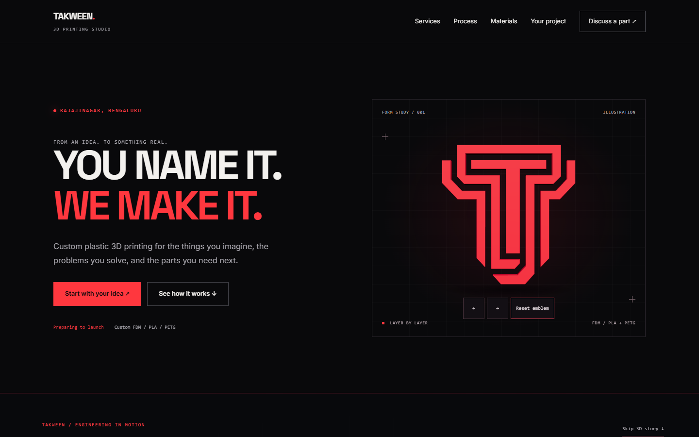
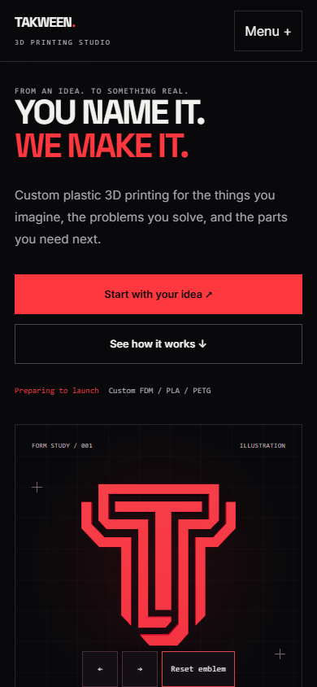
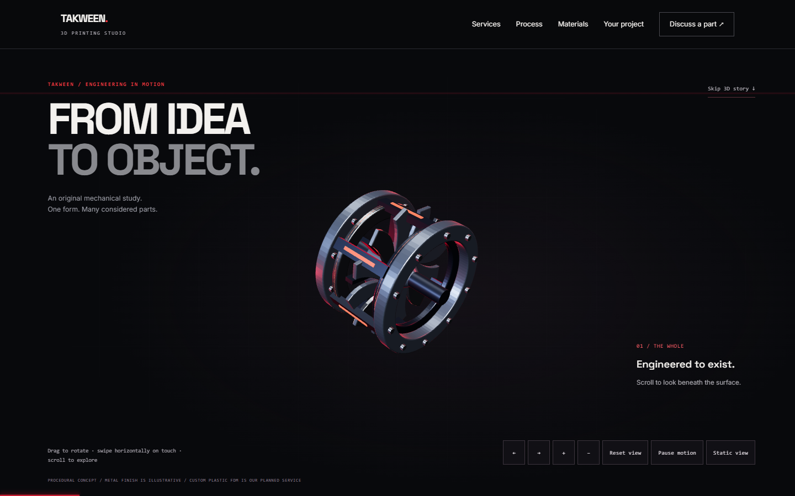
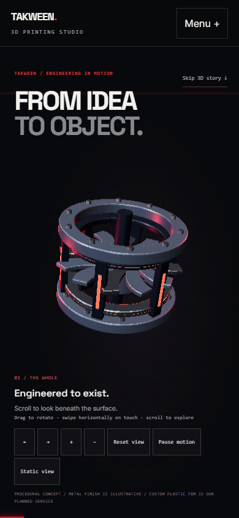

# Release-stage review — combined release

22 November 2026. Branch codex/combined-release. This stage prepares a draft PR; it does not authorize or perform deployment, indexing, DNS or domain changes.

## Landscape fix and preserved design

The 844x390 failure came from the original sticky stage's 650px minimum height, which placed the control bar below the short viewport. A narrowly scoped landscape media query (height <=500px, width <=1024px) lets the stage fit the viewport and adjusts supporting text/control placement. The original gear viewport insets are retained. The regression now checks every control is fully in view and clicks Reset.

The gear component, renderer, geometry/material/lighting implementation and timeline match original f0d27a8. In particular, assembly-experience.tsx retains the original 180px preloading margin; the rejected half-stage loading gate is removed. mechanical-scene.tsx and assembly-timeline.ts are unchanged. The approved T code and email/security implementation have no changes in this stage. Desktop and portrait-mobile styling is unaffected by the landscape query.

The earlier GEAR_PRESERVATION.md records the state before this newly approved short-landscape adjustment, including the then-failing test. That failure is now resolved; original source behavior remains except for the explicitly approved landscape layout accommodation.

## Fresh automated checks

| Check | Result |
|---|---|
| Lint | PASS |
| TypeScript | PASS |
| Unit | 27 PASS |
| Native local workerd rate-limit test | PASS, mocked provider, first 5 accepted then 429 |
| Clean Linux dependency install | PASS, npm ci |
| Next.js production build | PASS, 16.4.5 Turbopack, 10 generated pages |
| OpenNext build | PASS, 1.20.16 |
| Wrangler dry run | PASS, no upload; 4938.19 KiB raw / 1046.31 KiB gzip |
| Browser against actual local Worker | 38 PASS, 8 intentional skips, 0 failures, ~155 seconds |
| 844x390 landscape | PASS: all controls visible, reset operable |
| Hero visible rotation/reset and seven layouts | PASS |
| Gear forward/reverse timeline, drag/reset and touch scrolling | PASS |
| Email accepted-contract/failure behavior | PASS with mocked provider |

The runtime candidate used localhost:8795 with a distinct local-only Worker name/self-reference to avoid interrupting the existing localhost:8788 preview. No real Cloudflare deployment occurred. Native rate bindings were connected locally. ENQUIRY_ENABLED and SITE_INDEXING_ENABLED stayed false. Actual Resend delivery and inbox receipt are unverified.

The Linux toolchain is isolated and checksum verified. No system package, live account, DNS, Supabase schema/policy or billing setting was changed. Eight browser cases are intentionally skipped where their Chromium-only interaction mechanism or duplicate viewport matrix does not apply to WebKit. No physical-device or real iPhone Safari claim.

## Visual review evidence

Captured from the current built local Worker. No screenshot mockups.

| Desktop | Portrait mobile |
|---|---|
|  |  |
|  |  |

Machine-readable [test summary](release-evidence/test-summary.json) and [mobile performance summary](release-evidence/mobile-performance.json) are committed for review. Raw Playwright results, full Lighthouse trace, screenshots and short recordings are retained locally under artifacts/release-stage and are ignored by Git. No customer data or credentials are included.

## Mobile performance investigation

Latest mobile Lighthouse 13.6.0 local Worker direct-hero sample: 39 performance, 13.3s LCP, 12490ms total blocking time, CLS .012. Lighthouse warned that the host CPU was slower than expected. This single local, throttled sample is not a field Core Web Vitals measurement, an actual phone test, or proof of an exact regression from the previous 45/50 samples.

The trace records roughly 16126ms script evaluation, 1883ms style/layout, 427ms script parsing/compilation and 132ms paint/render. The top three startup scripts are shared 3D runtime/scene chunks, accounting for most script evaluation. Earlier direct-entry probes confirmed that original early loading initializes both hero and gear WebGL contexts; this behavior is deliberately preserved as requested. These measurements establish main-thread startup scripting as the bottleneck category, but do not isolate a single minified function or measure GPU execution time.

The prior WebGL diagnostic wrappers found short CPU-side shader compile/link/status calls relative to long tasks. They are not a GPU benchmark and add overhead. Do not blame visible polygon count alone or remove/simplify either animation to improve a score. Next performance work should isolate procedural geometry/resource initialization, shared bundle execution and rendering task scheduling on representative mobile hardware, requiring visual-equivalence checks for any proposed changes. No animation-sacrificing optimization is included here.

## Remaining gates and release recommendation

- Draft PR/review: GO. Functional tests pass and screenshot evidence is ready for owner review.
- Public preview update or .com launch: NO-GO until separately approved. Mobile performance is not signed off; physical-device testing remains outstanding.
- Real email delivery: configure the verified sender and server-only credentials in an approved test environment, explicitly enable sending there, verify provider acceptance/delivery event and Gmail receipt. No real message was sent in this stage. See COMBINED_RELEASE.md for secure setup and manual test steps.
- Confirm rate-limit namespace IDs are unused in the target account and understand the limits are approximate/per-location, not a strict worldwide budget. Existing build-tool advisories remain documented; no forced dependency downgrade/upgrade was introduced.
- CI workflow is prepared, with no deployment step. Remote CI status must be read from GitHub, not inferred from local checks.
- Appearance and eventual publication approval remain with the owner. Keep indexing off and the existing live Worker unchanged.
